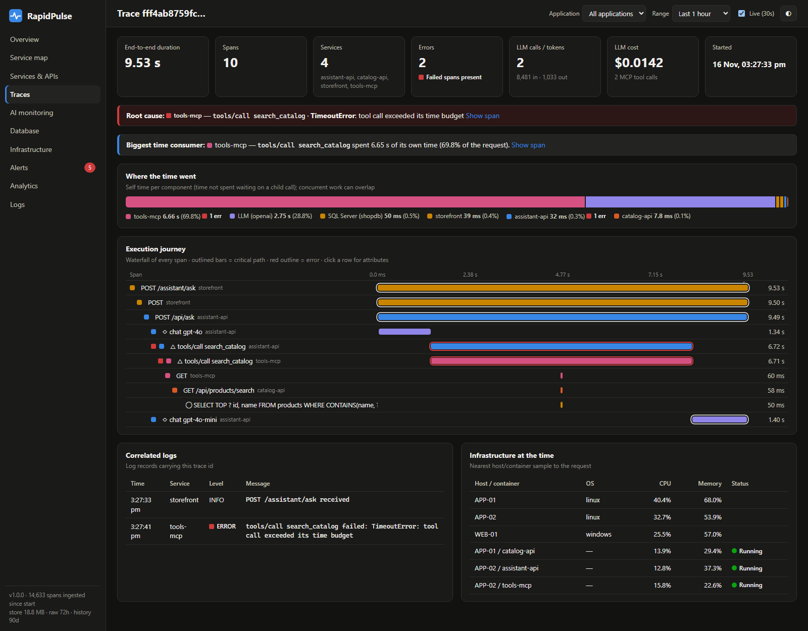
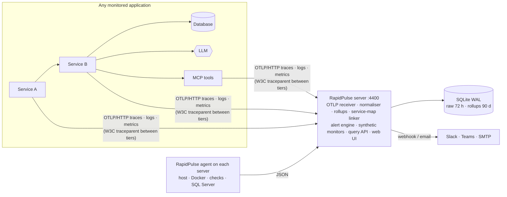
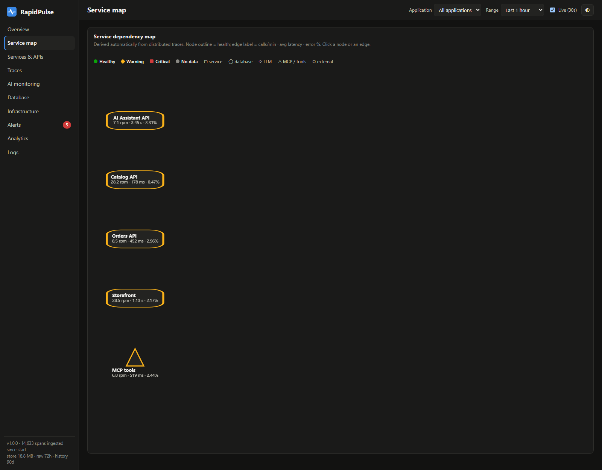

# RapidPulse

A general-purpose, centralised **Application Performance Monitoring and API
observability** platform in the style of AppDynamics or Dynatrace. It is built
on OpenTelemetry, so it monitors **any** application, in any language
(Python, .NET, Java, Node, Go …), and isn't tied to a vendor. Nothing in the
platform code is specific to one application. An application is simply
whatever sends telemetry with a given `service.namespace`, and one RapidPulse server
monitors many applications side by side.



The main feature is **end-to-end distributed tracing**. Every request is one
trace ID across every tier. RapidPulse names the **root cause** (the deepest failing
call), the **biggest time consumer** (self time, not overlapping wall-clock
time), the **critical path**, and the time used by each service, API, LLM, MCP
tool and database. It also shows the correlated logs and the host and container
state at that moment.

## Quick start

```powershell
python -m venv .venv; .venv\Scripts\pip install -r requirements.txt
.\scripts\run-demo.ps1                     # demo-shop example: server + 2 h history + live traffic
.\scripts\run-demo.ps1 -Example lumina     # another example application
# open http://127.0.0.1:4400
```

Or run `docker compose --profile demo up -d`. The demos use the simulator,
which sends real OTLP/HTTP (exactly what instrumented services send) for an
application described in a YAML **topology** file, and rotates the incidents
defined in it.

| Example | What it is |
|---|---|
| [`examples/demo-shop`](examples/demo-shop) | **Default.** A fictional online shop: web storefront (Windows), orders, catalog and AI-assistant APIs (Linux containers), an MCP tool server, SQL Server, Redis, OpenAI, an external payment gateway. The topology file is fully commented and doubles as the format reference. |
| [`examples/lumina`](examples/lumina) | An AI BI chatbot (Web → Lumina API → MCP → Fabric → Cube → SQL Server, AWS Bedrock). Includes a code-level integration guide written from a scan of that code base. |

## Monitoring your own application

You don't change RapidPulse; you only send it data.

1. **Traces and logs.** Point each service's OpenTelemetry exporter at RapidPulse:
   ```
   OTEL_EXPORTER_OTLP_ENDPOINT=http://<pulse>:4400
   OTEL_EXPORTER_OTLP_HEADERS=x-pulse-key=<key>          # if ingest keys are on
   OTEL_SERVICE_NAME=<service>
   OTEL_RESOURCE_ATTRIBUTES=service.namespace=<application>,deployment.environment.name=<env>
   ```
   Zero-code auto-instrumentation exists for Python, .NET, Java and Node
   ([`integrations/services.env.example`](integrations/services.env.example)).
   Ready-made pieces:
   - [`instrumentation/python/pulse_otel.py`](instrumentation/python/pulse_otel.py): one-call setup for Python, with `llm_span()` and `mcp_tool_span()` helpers.
   - [`integrations/nextjs`](integrations/nextjs): a Next.js front end or BFF.
   - [`integrations/cube`](integrations/cube): the Cube semantic layer.

   - [`deploy/instrument-container.py`](deploy/instrument-container.py): turns on tracing for an
     already-running **Python container** without changing its code. It rebuilds the container on its
     image plus OpenTelemetry, with identical settings, and rolls back automatically if the new
     container isn't healthy. Run `sudo python3 deploy/instrument-container.py <container> --server http://<pulse>:4400 --key <key> --app <application>`.
     Each request's headers and payload (up to 8 KB) are recorded on its trace, with secrets masked inside
     the container; change with `--capture-body-bytes N` (0 = off) and `--no-capture-headers`.
   - Other runtimes record request headers with their own OpenTelemetry settings, e.g. .NET:
     `OTEL_DOTNET_AUTO_TRACES_ASPNET_INSTRUMENTATION_CAPTURE_REQUEST_HEADERS=content-type,user-agent,...`
     (`..._ASPNETCORE_...` for ASP.NET Core).
   - [`integrations/dotnet-iis`](integrations/dotnet-iis): request **payloads** for ASP.NET (.NET Framework) and
     ASP.NET Core sites on IIS. `install-request-capture.ps1 -App <name>` detects which one and installs a DLL
     (bin folder, or a .NET startup hook on the app pool); no code or `web.config` change. Other runtimes need the application (or a proxy) to set `http.request.body`.

   An existing OpenTelemetry Collector just adds an `otlphttp` exporter pointing at RapidPulse.
2. **Servers.** Install the agent on each server. First fill in
   [`rapidpulse-agent.conf`](rapidpulse-agent.conf): server address, key, application, role and
   health checks. Then run **one** file:
   - **Windows:** double-click [`install-agent-windows.bat`](install-agent-windows.bat).
   - **Linux:** run `sudo ./install-agent-linux.sh`. It also reports Docker containers.
   - **Windows web server (IIS):** fill in [`rapidpulse-webserver.yaml`](rapidpulse-webserver.yaml) and
     double-click [`install-webserver-windows.bat`](install-webserver-windows.bat). One run installs the host
     agent, the OpenTelemetry .NET agent for IIS, and request header and payload capture for each IIS
     application listed. Copy it with the `deploy`, `agent` and `integrations\dotnet-iis` folders.

   Each installer does the rest:
   - checks that RapidPulse is reachable and the key is accepted;
   - installs Python if needed;
   - sends a test sample;
   - registers an auto-starting service: the `RapidPulseAgent` task on Windows, the `rapidpulse-agent` unit on Linux.

   Copy the `agent` folder with the installer; the Windows installer also needs the `deploy` folder.
3. **Availability.** Add `monitors:` in [`config/pulse.yaml`](config/pulse.yaml).
4. **Optional:**
   - Add display names, tiers and per-service latency targets under `services:`.
     Give LLM-backed services a higher target, since they are slow by design.
   - If the application reports LLM data under its own attribute names, map them
     with `attribute_aliases:`.
5. **Optional: simulate it first.** Copy
   [`examples/demo-shop/topology.yaml`](examples/demo-shop/topology.yaml),
   describe your hosts, services, request flows and failure scenarios, and run
   `python simulator/simulate.py --topology my-app.yaml`. You can validate
   dashboards and alert rules before any service is instrumented.

What RapidPulse understands is driven by the OpenTelemetry semantic conventions, not
by application names:

| Signal | Recognised from |
|---|---|
| HTTP APIs | `http.request.method`, `http.route`, `http.response.status_code`, `server.address`, `peer.service` |
| Databases | `db.system`, `db.namespace`, `db.query.text` (literals stripped) |
| LLM calls | OTel GenAI `gen_ai.*` and OpenInference `llm.*`, plus your `attribute_aliases`; cost from `llm_pricing` (built in for current Claude models, including cache reads/writes; nested spans of one call are counted once) |
| Request headers and payload | `http.request.header.*` and `http.request.body` (sensitive headers and fields masked) |
| MCP tools | `mcp.method.name`, `gen_ai.tool.name`, `rpc.system=mcp` |
| Application, host, container | resource `service.namespace`, `host.name`, `container.name`, `deployment.environment.name` |

## Architecture



| Layer | What it does |
|---|---|
| **Ingest** (`apm/otlp.py`, `apm/ingest.py`) | Standard OTLP/HTTP endpoints `/v1/traces`, `/v1/logs`, `/v1/metrics`: protobuf or JSON, gzip, optional API key. |
| **Normalise** (`apm/semantics.py`) | Classifies each span as HTTP / DB / LLM / MCP / internal by semantic conventions. Computes LLM cost. Removes SQL literals; masks secrets in attributes, request headers, payload fields and query strings. |
| **Store** (`apm/store.py`) | **Raw** spans and logs for trace search. **1-minute rollups** with latency histograms (p50/p95/p99, Apdex, status codes, tokens, cost) for dashboards and history. **Edges** for the service map. |
| **Analyse** (`apm/query.py`) | Service health, endpoints, service map, trace analysis (self time, critical path, root cause, bottleneck), AI, DB, infra, period-over-period reports. |
| **Alert** (`apm/alerts.py`, `apm/monitors.py`) | 22 metrics, 15 default rules, fan-out per service / host / model, firing→resolved lifecycle, acknowledge, webhook and SMTP. Central HTTP/TCP monitors. |
| **UI** (`apm/static`) | A single page with no build step, ECharts bundled locally (works offline), dark and light themes, application selector, live refresh, drill-down from any chart point to traces. |
| **Agent** (`agent/pulse_agent.py`) | Windows and Linux: CPU, memory, volumes, network, TCP connections, EC2 identity, Docker containers, HTTP/TCP checks, optional SQL Server metrics. |

## Features

| Area | Where |
|---|---|
| API monitoring: volume, latency percentiles, success/failure, HTTP status codes, errors | Overview, Services & APIs, service page, Logs |
| **Distributed tracing**: full journey, time per service, root cause | Traces (search by service, status, duration, endpoint, trace ID, any attribute or payload text) → Trace view |
| **Request headers and payload** of each API call, with **Copy as cURL** to replay it (secrets masked) | Trace view **Request** card, span details, trace PDF |
| AI monitoring: LLM and MCP calls, latency, tokens, failures, model usage, cost | AI monitoring |
| Database: query performance, slow queries, data-access APIs, connectivity | Database |
| Infrastructure: Windows/Linux servers, containers | Infrastructure; "infrastructure at the time" on every trace |
| Service map, generated from traces | Service map |
| Alerts: API failures, latency, downtime, resources, AI failures | Alerts |
| Real-time and historical analytics, filtering, drill-down, CSV export | Analytics |
| **PDF reports**: a technical *developer report* (endpoints, errors, slow traces, dependencies, database, AI, infrastructure, alerts) and a short *stakeholder summary* (overall status, key findings in plain language, service health, trends) | **Export PDF** in the top bar, or `GET /api/reports/pdf?audience=developer\|stakeholder&range=1h` |
| **Single-trace report**: one request as a PDF (request headers and payload, root cause, time breakdown, waterfall, span details, logs) | Trace page **Download trace report**, the **PDF** link on each trace row, or `GET /api/traces/<id>/pdf` |
| Time window: presets from 5 minutes to 30 days, or a custom start and end; **⟳** refreshes without waiting for the 30-second live update | Top bar |



## Operating it

* **Install on Windows (one step):** double-click `install-rapidpulse.bat`. It
  installs Python if needed, sets up auto-start and the firewall, and generates
  the ingest key and admin password. For EC2, including fully automatic install
  at launch through User Data, see [docs/WINDOWS-EC2.md](docs/WINDOWS-EC2.md).
* **Run manually:** `python -m apm.server` (port 4400), or `docker compose up -d`.
  Configuration: `config/pulse.yaml`, or the file named by `PULSE_CONFIG`.
  Machine-specific settings and secrets go in `config/pulse.local.yaml`, which overrides `pulse.yaml`.
* **Retention:** `storage.raw_retention_hours` (72) and `rollup_retention_days` (90).
* **Security:** ingest API keys, optional basic auth for the UI (or an SSO
  reverse proxy), attribute redaction, SQL literal stripping, masking of sensitive
  query parameters, request headers (authorization, cookies, keys, tokens) and payload
  fields (passwords, secrets, tokens, API keys). Request payloads are capped
  (`security.max_request_body_bytes`, 0 = never stored). No prompt or completion text is stored.
* **LLM cost:** `llm_pricing` in `apm/config.py` holds current Claude list prices per 1M tokens
  (e.g. Opus 5.5: $4 input, $20 output, $0.20 cache read). Add or override rows in `pulse.yaml`;
  unknown models show as "not priced". Prices charged by cloud providers can differ.
* **Tests:** `python -m pytest tests` (22 end-to-end tests). One of them fails
  if an application name appears in the platform code, which keeps the core
  application-neutral.
* **Screenshots:** `scripts/screenshot.ps1` (headless Edge).

### Known limits

* **Single node, SQLite.** That suits one or a few applications. The SQL is
  portable to PostgreSQL/TimescaleDB and ClickHouse for more volume. Put an
  OpenTelemetry Collector in front for tail sampling.
* **Percentiles** come from log-scale histograms, accurate to about ±12%.
* **Access control.** There is no built-in RBAC or SSO; use an identity proxy.

## Layout

```
apm/              platform: config, otlp, semantics, store, ingest, query, alerts, monitors, server, static/ (UI)
agent/            infrastructure agent (Windows/Linux, Docker, checks, SQL Server)
simulator/        topology-driven OTLP traffic generator
instrumentation/  pulse_otel.py: one-call OTel setup + GenAI/MCP span helpers for Python
integrations/     generic snippets: OTEL env vars, Next.js hook, Cube image
deploy/           agent installers (Windows scheduled task / systemd)
config/pulse.yaml neutral default configuration
examples/         sample applications: topology.yaml (+ pulse.yaml, integration notes)
tests/            end-to-end tests
```
